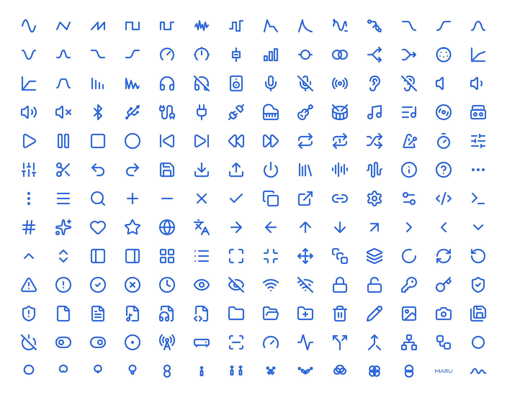

[](https://maru.audio)

# Maru Icons

SVG icons for interfaces and audio tools: waveforms, instruments,
transport, monitoring, modulation, filters, routing and everyday interface symbols.

Source and contributions: [maru-audio/maru-icons](https://github.com/maru-audio/maru-icons).

Browse and customize the collection at [PluginUI](https://pluginui.com/icons).



## Install

```sh
pnpm add maru-icons
```

```tsx
import { SineWaveIcon, HeadphonesIcon } from "maru-icons/react"

<SineWaveIcon size={48} color="currentColor" strokeWidth={2} />
<HeadphonesIcon nonScalingStroke aria-label="Monitoring" />
```

Components accept standard SVG props, refs, `size`, `color`, `strokeWidth`,
`nonScalingStroke` and `absoluteStrokeWidth`. Defaults are 24 px and inherited
color. Named imports are tree-shakable; individual components are available at
`maru-icons/react/sine-wave`. React 18 and 19 are supported. Icons are decorative
by default: label icon buttons on the button, and give meaningful standalone
icons an `aria-label` or `title`.

Plain SVG users need no React dependency:

```js
import { iconCatalog, iconToSvg } from "maru-icons"
const icon = iconCatalog.find((icon) => icon.name === "sine-wave")
const svg = iconToSvg(icon, { size: 48, color: "currentColor" })
```

Static SVG files are available at `maru-icons/svg/<id>.svg`.

## Build with Maru

Maru Icons is used in the Maru framework and works anywhere you need SVG or
React icons. Pair it with PluginUI controls to build interfaces for instruments,
effects and audio tools—including Audio Unit and VST3 plugin interfaces,
browser instruments and standalone apps. The icons have no Maru runtime dependency.

| Explore                                             | What you can build with it                                                      |
| --------------------------------------------------- | ------------------------------------------------------------------------------- |
| [PluginUI components](https://pluginui.com/components) | Knobs, faders, meters and other interactive controls alongside these icons      |
| [Maru Engine](https://maru.audio/engine)                  | Instruments, effects and MIDI tools with shared authoring and runtime contracts |
| [Maru documentation](https://maru.audio/docs)             | Project setup, module authoring, supported build targets and plugin delivery    |
| [Maru framework and CLI](https://github.com/maru-audio/MARU)      | The public package landing page and command-line workflow                       |
| [Maru agent skill](https://github.com/maru-audio/maru-skill)              | Guidance for coding agents working on Maru projects                             |

For format-specific builds, see [packaging and releasing plugins](https://maru.audio/docs/packaging-and-releasing-plugins).

## Build and contribute

In a clone of the source repository, use Node.js 24 and pnpm. Run `pnpm install`,
`pnpm build`, `pnpm test` and `pnpm typecheck`. Geometry and metadata live in `icons.json`; the build generates
React components and SVGs. Brand assets in `assets/brand/` are managed projections.
Run `pnpm preview` to regenerate `icons-preview.png` from the complete icon
catalog. The normal build does this too; add an icon and rebuild to update the
preview automatically. Sharp is used only for development, not at runtime.

README content lives in `github/README.md`; the build generates the root README
shared by GitHub and npm.

Missing an icon? Consider a pull request so everyone can benefit. Sharing these
building blocks is part of the Maru philosophy: less time recreating the same
things, more time building better audio tools together.
See [the contribution guide](CONTRIBUTING.md).

## Copyright and trademarks

© 2026 Maru Audio. All rights reserved.
Original artwork and code use the [Maru Icons License](LICENSE). Contributors retain
copyright in their contributions. Curated third-party artwork retains its
[upstream notices](licenses/lucide-LICENSE); see [licensing details](LICENSING.md).

Use, modification, redistribution and resale are allowed, including in icon
packs, UI kits and frameworks, without separate permission or a royalty.
Preserve the applicable copyright/license notices and respect trademarks.

Planning to include Maru Icons in a kit or framework, or resell the collection?
[Contact us](https://maru.audio/contact)—we would love to hear about it and help this
collection benefit the community. Contact and contribution are optional.

Maru™, the Maru logo and the Maru Wave mark are trademarks of Maru Audio.
`MaruLogoIcon` and `MaruWaveIcon` are brand marks. Their copyright license does
not grant trademark rights or permission to imply endorsement.
See [trademark guidance](TRADEMARKS.md).
